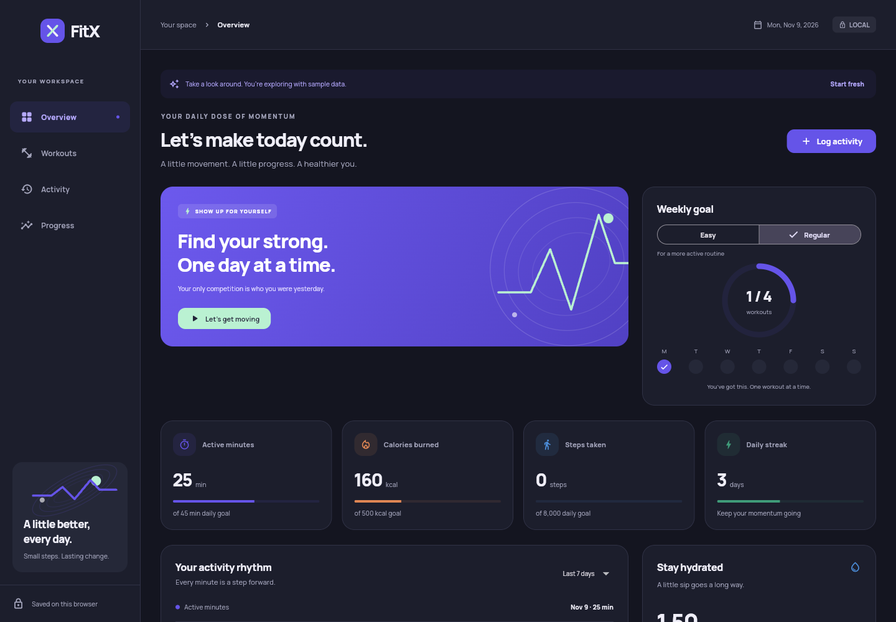
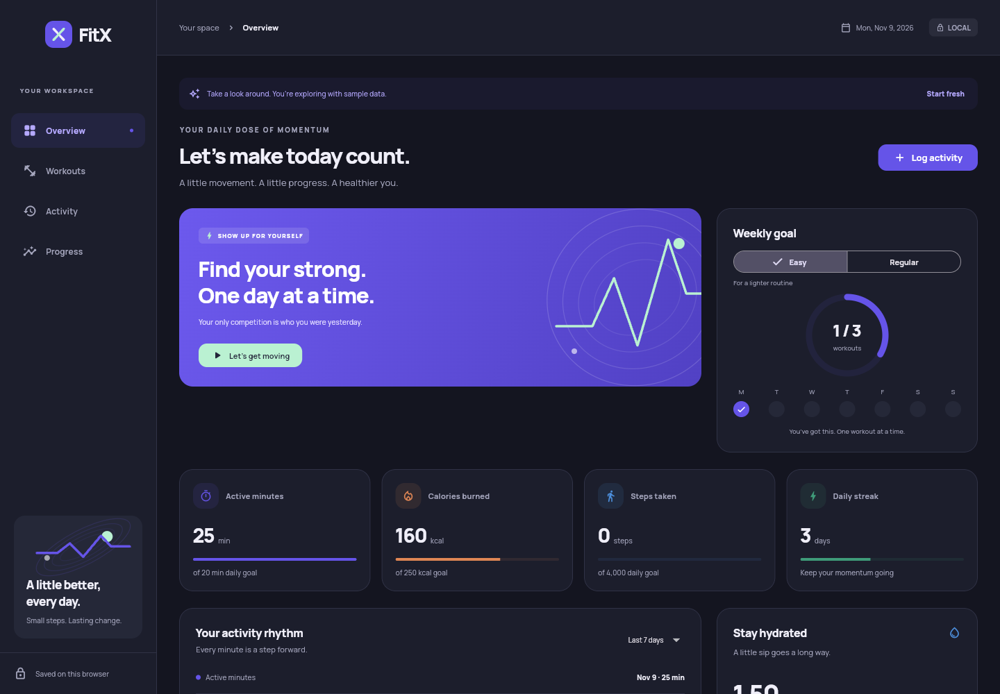
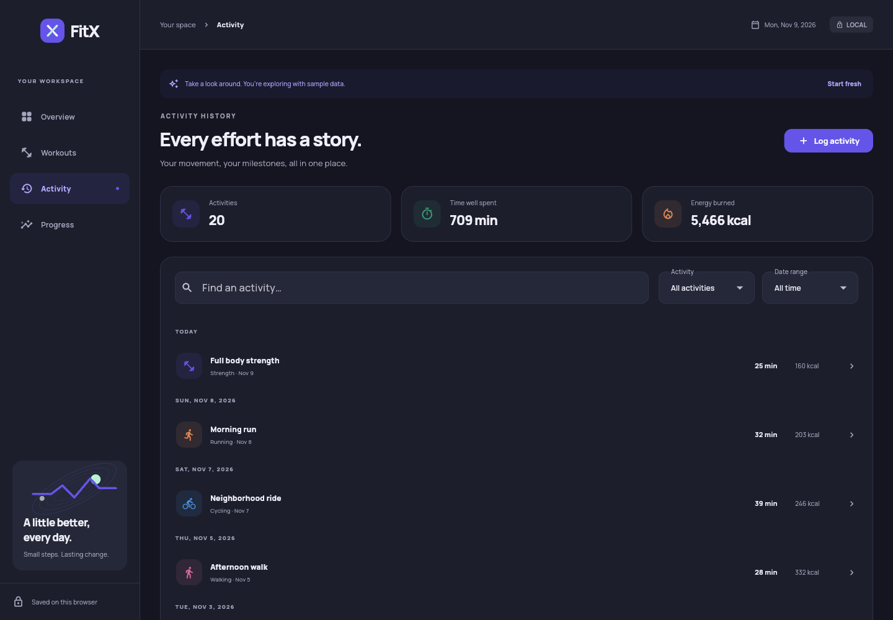
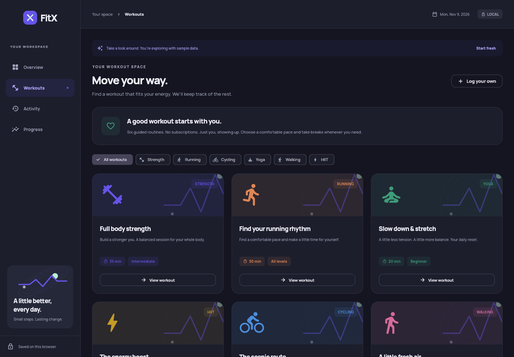
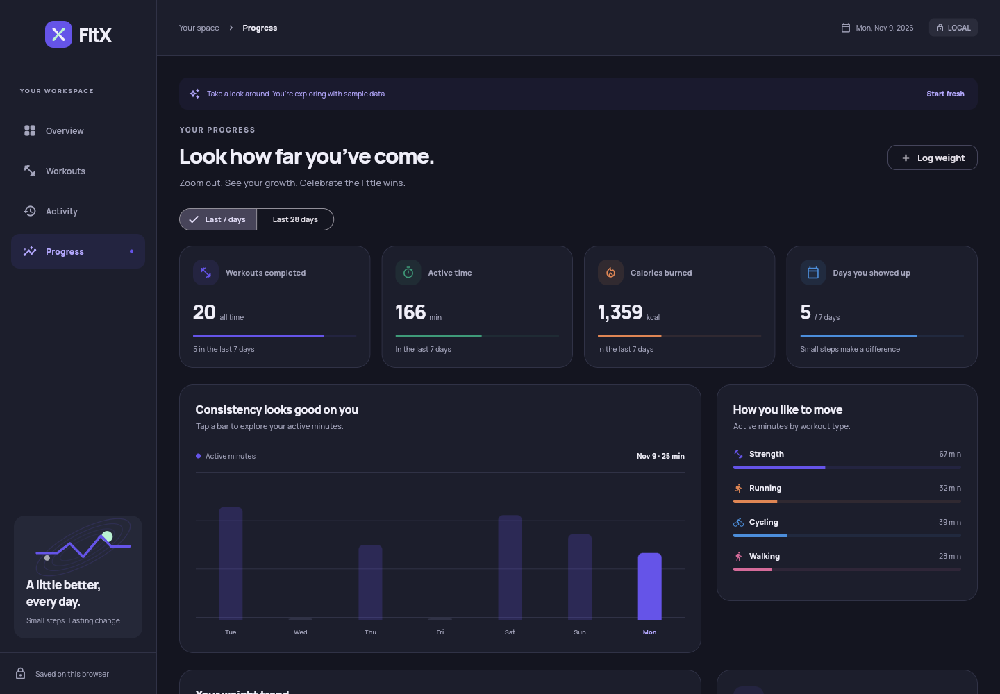
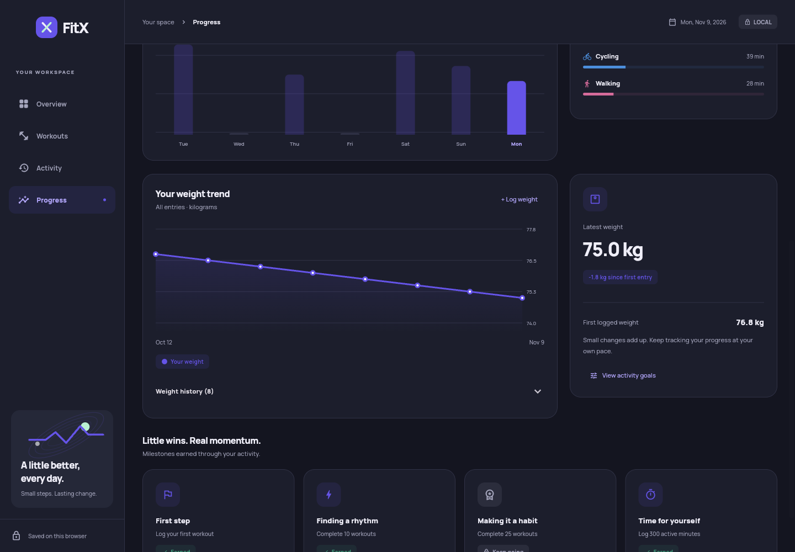
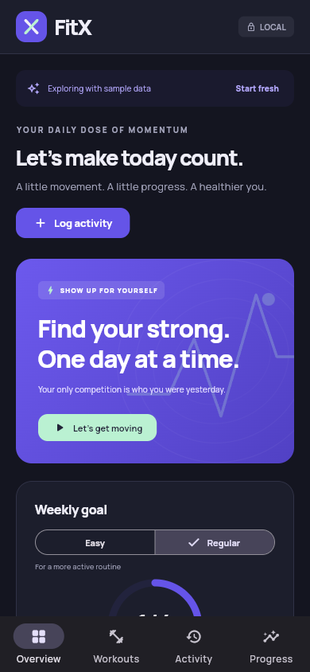
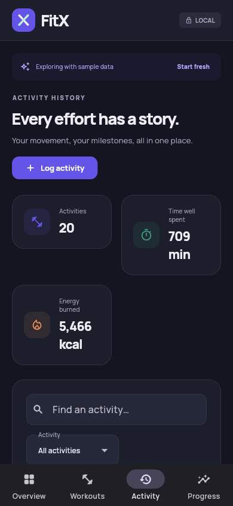

# FitX

**Your everyday fitness companion, built with Flutter.**

FitX helps you log workouts, follow guided routines, track water intake, and see your progress over time. It runs in your browser and adapts to desktop, tablet, and phone screens. No account is required.

**[Open FitX in your browser](https://vishalred6.github.io/FitX-flutter/)**

New here? Open the app, explore the sample data, and follow the walkthrough below. You only need to install Flutter if you want to run the project on your own computer.



## Contents

- [What you can do](#what-you-can-do)
- [How to use FitX](#how-to-use-fitx)
- [Where your data is saved](#where-your-data-is-saved)
- [Run the project on your computer](#run-the-project-on-your-computer)
- [Troubleshooting](#troubleshooting)
- [Project files](#project-files)

## What you can do

- Log strength training, running, cycling, yoga, walking, and HIIT activities.
- Follow six built-in workout routines with exercise checklists and a timer.
- Choose an Easy or Regular goal level.
- Record water intake in 250 ml steps.
- Search, edit, and delete past activities.
- Track weight, activity trends, workout totals, and earned milestones.

## How to use FitX

### 1. Explore the app and start your own records

On your first visit, FitX opens with **sample activities and weight entries** so you can see how the dashboard and charts work. The screenshots in this guide show that sample data; your numbers and dates will differ.

Use the four navigation options to move around:

| Page | What it is for |
| --- | --- |
| **Overview** | Today's totals, weekly goals, water intake, and recent activities |
| **Workouts** | Guided routines and your current workout session |
| **Activity** | Your activity history, search, and filters |
| **Progress** | Activity charts, weight tracking, and milestones |

Before recording your own activity, select **Start fresh** in the sample-data banner and confirm. This clears activities, weight entries, hydration records, and any active workout, while keeping your selected goal level. Any personal entries you added while exploring are also cleared.

### 2. Choose goals and record water

On **Overview**, find the **Weekly goal** card and choose **Easy** or **Regular**. The app updates the targets automatically.

| Target | Easy | Regular |
| --- | --- | --- |
| Workouts per week | 3 | 4 |
| Active minutes per day | 20 | 45 |
| Steps per day | 4,000 | 8,000 |
| Calories per day | 250 kcal | 500 kcal |
| Water per day | 2 L | 2.5 L |



Scroll down to **Stay hydrated**. Select **+ 250 ml** each time you drink that amount, or the minus button to correct an entry. The displayed total starts at zero each new day.

Steps and water are entered manually. FitX does not automatically read activity from your phone or a fitness watch.

### 3. Log an activity and find it later

1. Select **Log activity** on Overview or Activity. You can also select **Log your own** on Workouts.
2. Enter an **Activity name**, choose the **Activity type**, and select the date.
3. Enter the **Duration** in minutes.
4. Optionally add calories, distance in kilometres, steps, and notes. Leave calories blank to let FitX estimate them from the activity, duration, and your latest logged weight. It uses 75 kg if you have no weight entries.
5. Select **Save activity**. Your activity appears in the history and updates the relevant totals and charts.

For example, log a **Morning walk** as **Walking**, with a duration of **20 minutes**. Add distance and steps if you know them.

Open **Activity** to review your records. Type in **Find an activity…**, or use the **Activity** and **Date range** filters to narrow the list. Select an entry to see its details, then choose **Edit** to correct it or **Delete** to remove it after confirmation.



### 4. Follow a guided workout

1. Open **Workouts**. Choose a type filter, or leave **All workouts** selected.
2. Select **View workout** on a routine to read its exercises and instructions.
3. Select **Start this workout** to begin the session and timer.
4. Check off exercises as you complete them. Use **Pause timer** and **Resume timer** when needed.
5. Select **Finish workout**, add optional notes, and select **Save workout** to add it to your activity history.

You can save a partial workout even if you have not checked off every exercise. If you leave the session page, return to **Workouts** and select **Resume workout**. Only one workout session can be active at a time.

To abandon a session, select **Discard session** and confirm. That session will not be added to your history.



### 5. Track progress and weight

Open **Progress** and choose **Last 7 days** or **Last 28 days** to review your activity. Select a bar in the activity chart to see that day's active minutes. The page also shows your activity mix and earned milestones.



To record your weight:

1. Select **Log weight**.
2. Enter your weight in **kilograms** and choose the date.
3. Select **Log weight** in the dialog to save it.
4. Scroll down to **Your weight trend** to see the chart. Expand **Weight history** to review entries or delete an incorrect one.

A new weight entry replaces any existing entry for the same date. The weight chart shows all your weight entries, regardless of the activity date range selected above.



### 6. Use FitX on your phone

Open the same [FitX link](https://vishalred6.github.io/FitX-flutter/) in your phone's browser. On small screens, the navigation moves to the bottom. Tap **Overview**, **Workouts**, **Activity**, or **Progress**, and scroll to reach the rest of each page.

<p>
  
  
</p>

## Where your data is saved

FitX saves your records automatically in the browser you are using, through `shared_preferences`. Keep using the same browser, browser profile, and site address to return to those records.

- Records do **not** sync between devices or browsers. Your phone and computer have separate data.
- Clearing the site's browser data removes the saved records. Private browsing may discard them when the session ends.
- The hosted app and a locally running copy have separate storage. For local use, the fixed port in the instructions below helps keep the address consistent.
- There is currently no account, cloud backup, or export/import feature.

## Run the project on your computer

You can skip this section if you only want to use the [hosted app](https://vishalred6.github.io/FitX-flutter/).

### What you need

- [Git](https://git-scm.com/downloads) to download the repository.
- [Flutter SDK](https://docs.flutter.dev/install), available in your terminal. This project's GitHub workflow uses **Flutter 3.47.9**; `pubspec.yaml` requires **Dart 3.13.7 or newer within Dart 3**. Dart comes with Flutter.
- Google Chrome to run the web app with the command below.

This repository currently includes the **web** platform. The phone screenshots show the responsive web app.

### Download and start

Open a terminal and run these commands one at a time:

```bash
git clone https://github.com/vishalred6/FitX-flutter.git
cd FitX-flutter
flutter --version
flutter doctor
flutter pub get
flutter run -d chrome --web-port 8080
```

`flutter doctor` checks your setup. For this project, focus on issues affecting Flutter and Chrome/web development. You do not need Android Studio or Xcode just to run the web app.

Flutter opens Chrome with the app at `http://localhost:8080`. Keep the terminal running while you use it. To stop the app, press **Ctrl+C** in that terminal. To start it again later, open a terminal in the `FitX-flutter` folder and run the last command again.

### Optional: check the code or build the website

Run these from the project folder to analyze the code and run its tests:

```bash
flutter analyze --fatal-infos
flutter test
flutter test --platform chrome
```

To create a release build for a web server:

```bash
flutter build web --release
```

The generated website is placed in `build/web/`. For this repository's hosted app, the [GitHub Actions workflow](.github/workflows/deploy-pages.yml) runs checks, builds with the GitHub Pages base path, and deploys after a push to `main`.

## Troubleshooting

| Problem | What to try |
| --- | --- |
| `flutter: command not found` or Flutter is not recognized | Install Flutter, add its `bin` folder to your PATH following the installation guide, and reopen your terminal. |
| Dependency installation reports an SDK version error | Check `flutter --version` and use Flutter 3.47.9, the version configured in the project workflow. Then run `flutter pub get` again. |
| Chrome is not detected | Install Chrome and run `flutter devices` to check whether Flutter can find it. |
| Port 8080 is already in use | Stop the other process or choose another port, such as `--web-port 8081`. A different port has separate saved browser data. |
| The app says saved data could not be opened | Allow site storage in your browser and select **Retry loading**. **Reset saved data** replaces existing saved data; use it only if you intend to clear it. |
| Changes could not be saved | Check that browser storage is allowed, then select **Retry saving** in the banner before closing the app. |
| Your records seem to be missing | Check that you are using the same device, browser profile, and site address. A new browser starts with sample data. |

## Project files

If you want to explore how FitX works, start here:

| File or folder | Purpose |
| --- | --- |
| `lib/main.dart` | Starts the app |
| `lib/app.dart` | Navigation and the shared page layout |
| `lib/dashboard.dart` | Overview, goals, and hydration |
| `lib/workouts.dart` | Workout library and guided sessions |
| `lib/history.dart` | Activity history, search, and filters |
| `lib/progress.dart` | Charts, weight history, and milestones |
| `lib/dialogs.dart` | Forms for activities and weight |
| `lib/controller.dart` | Updates records, calculates totals, and saves data |
| `lib/models.dart` | Data structures, goal targets, and built-in routines |
| `lib/ui.dart` | Shared visual components and styling |
| `test/` | Automated tests |
| `screenshots/` | Screenshots used in this guide |
| `pubspec.yaml` | Dependencies, SDK requirement, and font configuration |
